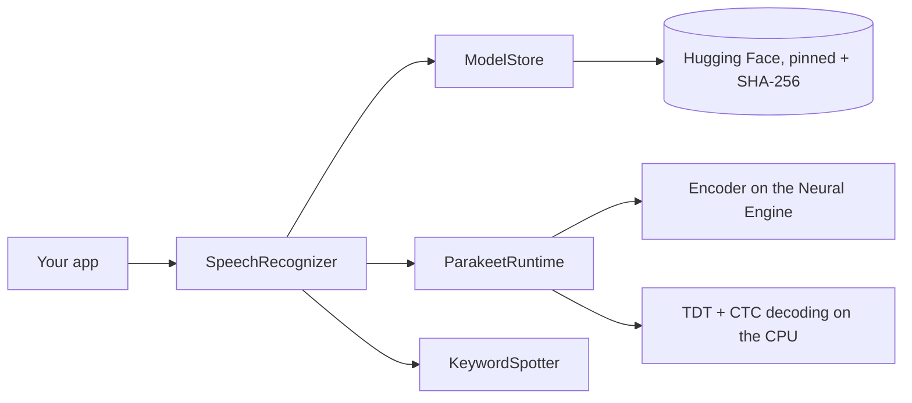

<p align="center">
  
</p>

<p align="center">
  
</p>

<p align="center">
  <a href="https://git.io/typing-svg">
    
  </a>
</p>

<p align="center">
  
  
  
  
  
</p>

<p align="center">
  
</p>

<p align="center">
  <a href="https://github.com/BuilderHelm/BuilderHelmAudio/releases/latest">
    
  </a>
  <a href="https://huggingface.co/BuilderHelm">
    
  </a>
</p>

BuilderHelmAudio is a Swift package for speech recognition on iPhone, iPad and Mac. Load a model, pass it a recording, and get the transcript with token times.

It downloads [BuilderHelm's Parakeet models](https://huggingface.co/BuilderHelm) from Hugging Face, checks every file against a pinned SHA-256, keeps them on the device and runs them locally on the Neural Engine. No audio leaves the device.

Code is MIT. Models are CC-BY-4.0, from NVIDIA's [Parakeet-TDT-CTC-110M](https://huggingface.co/nvidia/parakeet-tdt_ctc-110m).

---

## Features

- **Fast** — about 1,000× real time on a Mac (M5), 400–600× on an iPhone 13.
- **Accurate** — 2.46% WER on LibriSpeech test-clean (TDT).
- **Simple** — one call to download and load, one call to transcribe.
- **Token times** — TDT transcripts carry the time of every token, plus a CTC transcript from the same pass.
- **Keyword spotting** — find names and terms in audio, with start and end times. No tokenizer needed.
- **Verified downloads** — every file is pinned to a Hugging Face commit and checked by SHA-256. Interrupted downloads resume file by file.
- **Any audio** — any format AVFoundation reads, or raw samples; converted to 16 kHz mono.
- **Any length** — long recordings are split into overlapping windows and joined without repeating words.
- **Command line** — `bhaudio` transcribes, spots keywords and benchmarks on macOS.

---

## Supported models

| Model | Best for | Download | Mac M5, short clips | Mac M5, long audio | iPhone 13, 6 s clip | iPhone 13, 72 s recording |
|---|---|---:|---:|---:|---:|---:|
| **`.parakeetTdtCtc110M`** | Transcription with token times, plus CTC | 144 MB | 860× | 791× | 393× (15 ms) | 308× (233 ms) |
| **`.parakeetCtc110M`** | Fastest transcription and keyword spotting | 124 MB | 1,071× | 998× | 604× (10 ms) | 415× (173 ms) |

Speed is × real time. Mac numbers and accuracy are from the model cards: [TDT + CTC](https://huggingface.co/BuilderHelm/Parakeet-TDT-CTC-110M-CoreML), [CTC](https://huggingface.co/BuilderHelm/Parakeet-CTC-110M-CoreML). iPhone 13 numbers are the median of 10 runs of the demo app's samples on iOS 27.2; transcripts match the Mac word for word. English only.

Each model is pinned to a Hugging Face commit, so a given SDK version always runs the same files.

---

## Quick start

1. **Add the package.** In Xcode: **File → Add Package Dependencies…** and enter `https://github.com/BuilderHelm/BuilderHelmAudio`.
2. **Load a model.** The first call downloads and verifies it; later calls load it from the device.
3. **Transcribe** a file or samples.

```swift
import BuilderHelmAudio

// Downloads the model on first use (144 MB), then loads it from the device
let recognizer = try await SpeechRecognizer.load(.parakeetTdtCtc110M) { progress in
    print("Downloading \(Int(progress.fraction * 100))%")
}

let transcript = try await recognizer.transcribe(file: audioURL)
print(transcript.text)                       // TDT transcript
print(transcript.tokens.first?.time ?? 0)    // token times in seconds
```

You can also pass samples:

```swift
let transcript = try await recognizer.transcribe(samples: samples16kHzMono)
```

Load the recognizer once and reuse it. Calls run off the caller's thread, one at a time.

Or add it in `Package.swift`:

```swift
dependencies: [
    .package(url: "https://github.com/BuilderHelm/BuilderHelmAudio", from: "0.1.0"),
],
targets: [
    .target(name: "MyApp", dependencies: ["BuilderHelmAudio"]),
]
```

---

## Keyword spotting

```swift
let recognizer = try await SpeechRecognizer.load(.parakeetCtc110M)
let hits = try await recognizer.spot(["BuilderHelm", "Neural Engine"], inFile: audioURL)
for hit in hits {
    print(hit.keyword, hit.score, hit.start, hit.end)   // score near 0 = confident
}
```

Phrases are case-sensitive. The default threshold is −1; spoken words usually score above −0.1. To score many phrases against one recording, transcribe once with `includeCtcLogProbabilities: true` and call `recognizer.keywordSpotter.detect(_:in:)` on `transcript.ctcLogProbabilities`.

---

## Model storage

Models are kept in `Application Support/BuilderHelmAudio` (excluded from iCloud backup on iOS):

```swift
let store = ModelStore.shared
store.isDownloaded(.parakeetCtc110M)
try await store.download(.parakeetCtc110M) { print($0.fraction) }
try await store.verify(.parakeetCtc110M)     // re-hash every file
try await store.remove(.parakeetCtc110M)
```

A file that fails its checksum is discarded. To ship a model inside your app instead, load its folder directly:

```swift
let recognizer = try SpeechRecognizer(directory: bundledModelFolder, model: .parakeetCtc110M)
```

---

## Command line (macOS)

```bash
swift run -c release bhaudio models
swift run -c release bhaudio transcribe audio.wav
swift run -c release bhaudio transcribe audio.wav --model parakeet-ctc-110m --json
swift run -c release bhaudio spot audio.wav "Neural Engine" BuilderHelm
swift run -c release bhaudio benchmark cases.json --rounds 3
```

`benchmark` takes a JSON array of `{"path": "...", "text": "optional reference"}` and reports real-time factor, latency percentiles and WER.

---

## Requirements

- iOS 18+ or macOS 15+
- Swift 6 (Xcode 16 or later)
- Apple Silicon or an A-series chip with a Neural Engine for full speed; `computeUnits: .gpu` or `.cpu` also work
- Disk: about twice the download per model (124–144 MB), including the copy CoreML compiles on first load
- Network on first load only, to download the model from Hugging Face

---

## How it works

```text
Audio file or samples
  → 16 kHz mono
  → log-mel features (CPU)
  → FastConformer encoder (Neural Engine), in overlapping windows for long audio
  → TDT decoder (CPU, Accelerate) and greedy CTC
  → transcript, token times, keyword hits
```

The CPU decodes one window while the Neural Engine encodes the next.

---

## Privacy

BuilderHelmAudio makes one kind of network request: downloading model files from Hugging Face.

| What | Where it goes |
|---|---|
| Audio | Stays on the device. Never uploaded. |
| Transcripts | Returned to your app. Never stored or uploaded by the SDK. |
| Model files | Downloaded from `huggingface.co` at a pinned commit, or from your mirror via `ModelStore(baseURL:)` |
| Analytics | None |

---

## Build from source

```bash
git clone https://github.com/BuilderHelm/BuilderHelmAudio.git
cd BuilderHelmAudio
swift build -c release
```

---

## Verify

```bash
swift test                                   # unit tests
BUILDERHELM_INTEGRATION=1 swift test         # also downloads both models and transcribes
xcodebuild test -scheme BuilderHelmAudio-Package -destination 'platform=iOS Simulator,name=iPhone 17 Pro'
```

The iOS Simulator has no Neural Engine, so its speed is not representative. For device numbers, use the demo app below.

---

## Architecture



| Target | Responsibility |
|---|---|
| `BuilderHelmAudio` | Public API: `SpeechRecognizer`, `ModelStore`, `KeywordSpotter`, `AsrModel` |
| `ParakeetRuntime` | CoreML + Accelerate Parakeet runtime, shared with the BuilderHelm model repositories |
| `bhaudio` | Command-line tool for macOS |
| `BuilderHelmAudioTests` | Unit, download and long-audio pipeline tests |

---

## Demo app

[`Examples/BuilderHelmAudioDemo.swiftpm`](Examples/BuilderHelmAudioDemo.swiftpm) is a small iPhone and iPad app: download a model, transcribe the bundled samples or the microphone, spot keywords and benchmark speed. Open it in Xcode, pick your team under **Signing & Capabilities**, and run it on a device. See its [README](Examples/BuilderHelmAudioDemo.swiftpm/README.md).

---

## Status

Version 0.1.0, the first release. Tested on an Apple M5 Mac (macOS 27.2) and an iPhone 13 (iOS 27.2). Other devices, battery use and heat are not yet measured. English only.

[File an issue](https://github.com/BuilderHelm/BuilderHelmAudio/issues/new) if something breaks.

## License

Code: [MIT](LICENSE). Models: CC-BY-4.0, from NVIDIA's [Parakeet-TDT-CTC-110M](https://huggingface.co/nvidia/parakeet-tdt_ctc-110m); see each model card.

<p align="center">
  <em>Speak. It transcribes. On the device.</em>
</p>

<p align="center">
  
</p>
